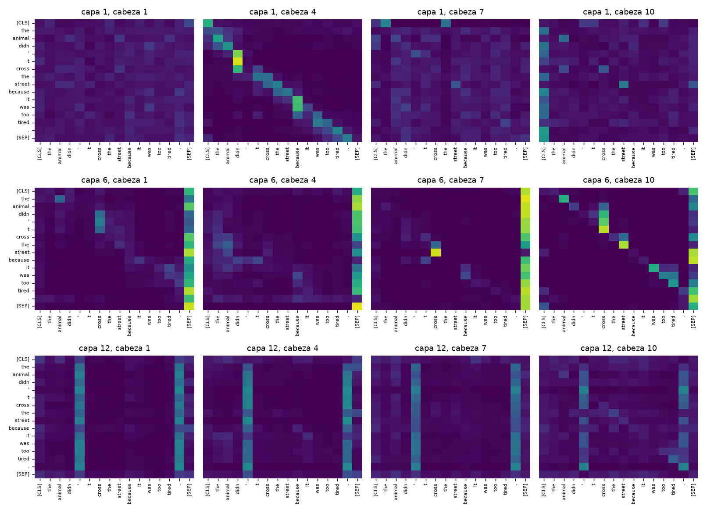
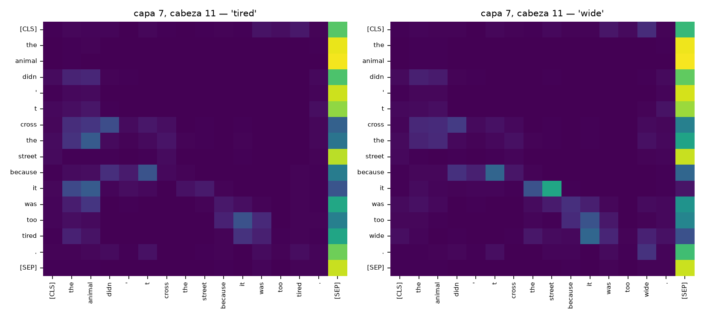
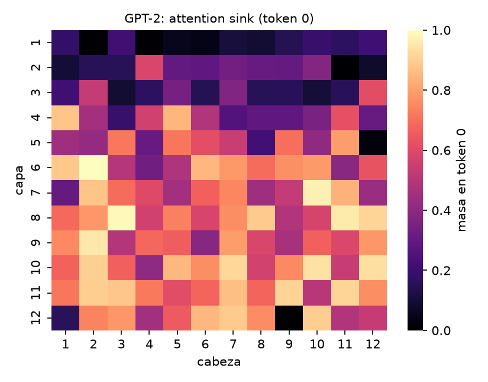
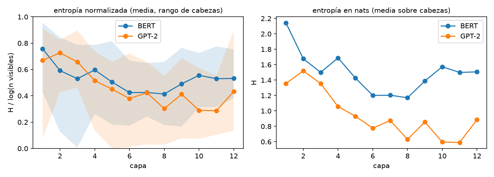

<h1 class="title">CC3092 — Deep Learning y Sistemas Inteligentes</h1>

Hoja de Trabajo #2: Transformers y Mecanismos de Atención

Nesstor · github.com/nesstor/deepLearning/tree/main/labs/hdb-transformers

# 1. De las RNN a la atención

En un seq2seq con RNN el codificador comprime toda la entrada en un único vector de contexto de tamaño fijo, que es un **cuello de botella**: la calidad cae con la longitud de la oración y el gradiente debe recorrer `T` pasos (desvanecimiento). **Bahdanau** (2014) permite que el decodificador consulte todos los estados del codificador: `e_{ij} = vᵀ tanh(W_s s_{i-1} + W_h h_j)` (atención **aditiva**, una MLP), `α_{ij} = softmax_j(e_{ij})`, `c_i = Σ_j α_{ij} h_j`. **Luong** (2015) usa scores **multiplicativos** (`sᵀh` o `sᵀWh`): equivalentes en calidad pero mucho más baratos, porque se reducen a un producto matricial. El Transformer generaliza esto con **Query/Key/Value**: la *query* de un token pregunta, las *keys* anuncian qué contiene cada token, y los *values* son lo que se lee; el resultado es un promedio de `V` ponderado por la compatibilidad `q·k`. La atención deja de ser un complemento de una RNN y pasa a ser la única forma de mezclar información entre posiciones.

# 2. Arquitectura Transformer

**Scaled dot-product**: `Attention(Q,K,V) = softmax(QKᵀ/√d_k) V`. Si las componentes de `q` y `k` son independientes con media 0 y varianza 1, `q·k` tiene varianza `d_k`; sin la división el softmax se satura y los gradientes se anulan. **Multi-head**: `h` cabezas con proyecciones propias de dimensión `d_k = d_model/h` atienden en paralelo y se concatenan con `W_O`; permiten que cada cabeza se especialice en un tipo de relación con el mismo costo total.

**Codificación posicional.** La atención es invariante a permutaciones, por lo que hay que inyectar el orden. *Sinusoidal*: `PE(pos,2i)=sin(pos/10000^{2i/d})`, `PE(pos,2i+1)=cos(·)`, sumada al embedding; el coseno entre posiciones decae con la distancia (fig. del notebook) y permite extrapolar de forma teórica. *RoPE*: rota cada par de dimensiones de `q` y `k` por `pos·θ_i`, de modo que `q_m·k_n` depende solo de `m−n` (verificado numéricamente: −6.36248 para `(3,1)`, `(10,8)` y `(103,101)`). Es posicional-relativa, no añade parámetros y es el estándar en LLM modernos.

**Bloque.** Residual + LayerNorm alrededor de la atención y de una FFN. *Post-LN* (original): `LN(x+F(x))`; *Pre-LN*: `x+F(LN(x))`. Pre-LN conserva un camino identidad limpio, tiene gradientes bien escalados al inicio y entrena sin *warm-up* delicado; Post-LN suele rendir algo mejor si converge pero es inestable en modelos profundos.

**Complejidad.** Autoatención: `O(T²·d)` tiempo y `O(T²)` memoria por cabeza, pero profundidad secuencial `O(1)` y camino máximo entre dos tokens `O(1)`; una RNN: `O(T·d²)` con profundidad secuencial `O(T)` y camino `O(T)`. Alternativas: **FlashAttention** (exacta; hace *tiling* en SRAM y no materializa la matriz `T×T` en HBM, memoria `O(T)` y mucho más rápida por menor tráfico de memoria), atención dispersa/ventana (Longformer, BigBird), aproximaciones lineales (Performer) y modelos de estado (Mamba).

**APIs usadas** (§1 del notebook): `F.scaled_dot_product_attention` (kernel fusionado; admite `is_causal`), `nn.MultiheadAttention` (`need_weights=True, average_attn_weights=False` devuelve pesos por cabeza; `attn_mask` aditiva o booleana, `key_padding_mask`), `nn.Transformer.generate_square_subsequent_mask` (máscara aditiva con `-inf` sobre la diagonal), y en Hugging Face `AutoModel.from_pretrained(..., attn_implementation="eager")` con `output_attentions=True` (la implementación SDPA no devuelve pesos).

# 3. Procedimiento matemático manual

Con `d_k=4`, `Q=[[1,0,1,0],[0,2,0,2],[1,1,0,0]]`, `K=[[1,0,0,1],[0,1,1,0],[1,1,1,1]]`, `V=diag(1,2,3)`:

- `QKᵀ = [[1,1,2],[2,2,4],[1,1,2]]` → dividir por `√4=2`: `[[.5,.5,1],[1,1,2],[.5,.5,1]]`.
- Softmax por fila: fila 1 = `e^{.5},e^{.5},e^{1}` / `(2e^{.5}+e)` = `[0.2741, 0.2741, 0.4519]`; fila 2 = `[0.2119, 0.2119, 0.5761]`.
- Salida `A·V`: fila 1 = `0.2741·[1,0,0]+0.2741·[0,2,0]+0.4519·[0,0,3] = [0.2741, 0.5481, 1.3556]`.
- Con máscara causal la fila 1 queda `[1,0,0]`, la fila 2 `[.5,.5,0]` y la fila 3 igual que antes.

El notebook comprueba que coincide con `F.scaled_dot_product_attention` y que `nn.MultiheadAttention` reproduce el cálculo manual por cabeza (a partir de `in_proj_weight`) con tolerancia `10⁻⁵`.

# 4. Experimentos en BERT y GPT-2

{width=88%}

**Patrones en BERT.** La atención es bidireccional (matriz llena). En las capas 2–10, 48–63% de la masa media cae en `[CLS]`/`[SEP]` (la capa 6 llega a 0.63), tokens de "reposo" para cabezas sin función útil en esa posición; en las capas 1 y 11–12 solo 9–21%. Hay cabezas puramente posicionales: en la capa 4 una cabeza pone 57% de su masa en el token previo y en la capa 3 una pone 93% en el siguiente. Estos patrones coinciden con los reportados por Clark et al. (2019).

**Correferencia** ("it" en *…too tired* vs *…too wide*). Para cada cabeza, `r = A[it→animal]/(A[it→animal]+A[it→street])`; se consideran solo cabezas con ≥5% de masa sobre los dos candidatos (61 de 144), porque `r` es ruido si no miran a ninguno. En promedio `r` pasa de 0.712 (*tired*) a 0.531 (*wide*), es decir, el contexto sí desplaza la atención hacia *animal*, pero solo 14 de 61 cabezas (23%) resuelven bien ambos casos, **lo esperable por azar (~25%)**, y se concentran en las capas 7–12. Hay cabezas concretas con comportamiento limpio: capa 7, cabeza 11 da `it→animal`=0.28, `it→street`=0.07 con *tired* y 0.01 / 0.59 con *wide*. Pero elegir la mejor de 61 cabezas sobre un único par de oraciones es selección (comparaciones múltiples), así que no se concluye que esa cabeza "haga correferencia".

{width=72%}

**GPT-2 causal.** En las 144 cabezas la masa sobre posiciones futuras es exactamente 0 y cada fila suma 1 (la matriz es triangular inferior). **Attention sinks**: 80/144 cabezas dejan >50% de su atención en el token 0 (máx. 0.996) y la masa crece con la profundidad (0.12 en la capa 1, ~0.75 en capas 8–11). Es un efecto **posicional y no semántico**: al cambiar la palabra inicial (`The`, `Ban`, `Quant`, `.`, salto de línea) la masa se mantiene en 0.52–0.53 con las mismas ~80 cabezas, mientras que `The` en la posición 1 recibe solo 0.025. Con la máscara causal el token 0 es el único visible para todos, y como el softmax obliga a repartir masa 1, sirve de vertedero cuando una cabeza no tiene nada que leer (Xiao et al., 2023).

GPT-2: masa de atención sobre el token 0 por capa × cabeza (izq.) y entropía normalizada por capa en BERT y GPT-2 (der.).

**Entropía.** Se calcula `H=−Σp log p` por fila, normalizada por `log(tokens visibles)` (en GPT-2 la fila `t` ve `t+1`), promediada sobre 6 oraciones. Ambos modelos arrancan con atención difusa (capa 1: BERT 0.76, GPT-2 0.67) y se vuelven más focalizados con la profundidad (BERT mínimo 0.41 en la capa 8; GPT-2 mínimo 0.29 en las capas 10–11, en parte por los sinks), con repunte en la última capa (0.53 y 0.43). Hay cabezas casi deterministas (entropía normalizada 0.007 y 0.002) y otras casi uniformes (0.95 y 0.91): las cabezas son heterogéneas.

# 5. Discusión

**Escalabilidad frente a las RNN.** Las RNN no se paralelizan en el tiempo (profundidad secuencial `O(T)`) y propagan la información en `O(T)` pasos; el Transformer procesa todos los tokens a la vez y conecta cualquier par en un paso, lo que explica que escale con datos, parámetros y cómputo (leyes de escala). El costo es `O(T²)` en memoria y en tiempo para el contexto, y en inferencia el *KV cache* crece linealmente con `T`. **Especialización de cabezas.** Los resultados muestran cabezas posicionales (token previo/siguiente), cabezas "de reposo" sobre `[CLS]`/`[SEP]`/token 0 y algunas con sensibilidad sintáctico-semántica (capa 7, cabeza 11); pero también redundancia: muchas cabezas se pueden podar con poca pérdida (Michel et al., 2019; Voita et al., 2019), y la mayor parte del comportamiento "interpretable" se concentra en pocas.

**¿Los pesos de atención explican?** Argumentos en contra (Jain y Wallace, 2019): los pesos pueden alterarse sin cambiar la predicción, y la atención no mide la importancia de un token porque el *value* y las capas siguientes también transforman la señal. Nuestros resultados lo ilustran: los *sinks* concentran 50–99% de la atención en un token semánticamente vacío, así que "mucha atención" no equivale a "mucha influencia". A favor (Wiegreffe y Pinter, 2019): depende de qué se entiende por explicación, y como diagnóstico de dónde se **lee** información sirve. Conclusión: es una pista útil, no una explicación causal; para atribuciones fiables hay que complementarla con intervenciones (ablación de cabezas, *attention rollout*, gradientes).

**Contextos de 100,000+ tokens.** `T²` es inviable: 10⁵ tokens implican 10¹⁰ pesos por cabeza y capa. Estrategias: (i) cálculo exacto eficiente (**FlashAttention**, **ring attention** para repartir la secuencia entre dispositivos); (ii) patrones dispersos, ventana deslizante + sinks (Longformer, BigBird, **StreamingLLM**, que retiene los primeros tokens por el fenómeno anterior); (iii) extensión de posiciones (**RoPE scaling**, interpolación de posiciones, YaRN) para generalizar más allá de la longitud de entrenamiento; (iv) reducir el KV cache (MQA/GQA, cuantización, compresión); (v) arquitecturas de costo lineal (Mamba, atención lineal); (vi) no meter todo en el contexto: recuperación (RAG) y memoria externa.

# Referencias

Vaswani et al. (2017). *Attention Is All You Need*. arXiv:1706.03762. · Bahdanau, Cho, Bengio (2014). *Neural Machine Translation by Jointly Learning to Align and Translate*. arXiv:1409.0473. · Luong, Pham, Manning (2015). *Effective Approaches to Attention-based NMT*. arXiv:1508.04025. · Su et al. (2021). *RoFormer: Rotary Position Embedding*. arXiv:2104.09864. · Xiong et al. (2020). *On Layer Normalization in the Transformer Architecture*. arXiv:2002.04745. · Dao et al. (2022). *FlashAttention*. arXiv:2205.14135. · Clark et al. (2019). *What Does BERT Look At?* arXiv:1906.04341. · Xiao et al. (2023). *Efficient Streaming Language Models with Attention Sinks*. arXiv:2309.17453. · Jain, Wallace (2019). *Attention is not Explanation*. arXiv:1902.10186. · Wiegreffe, Pinter (2019). *Attention is not not Explanation*. arXiv:1908.04626. · Michel, Levy, Neubig (2019). *Are Sixteen Heads Really Better than One?* arXiv:1905.10650. · Voita et al. (2019). *Analyzing Multi-Head Self-Attention*. arXiv:1905.09418. · Beltagy et al. (2020). *Longformer*. arXiv:2004.05150. · Gu, Dao (2023). *Mamba*. arXiv:2312.00752. · Peng et al. (2023). *YaRN*. arXiv:2309.00071. · Liu et al. (2023). *Ring Attention with Blockwise Transformers*. arXiv:2310.01889.
