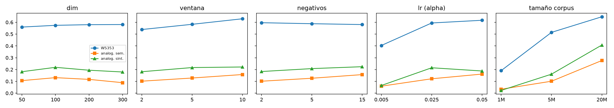
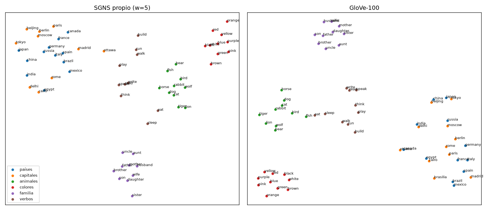

<h1 class="title">CC3092 — Deep Learning y Sistemas Inteligentes</h1>

Laboratorio #7: NLP end-to-end y Embeddings

Ernesto Ascencio · Carné 23009 git clone https://github.com/AscencioSIUU/deepLearning.git · carpeta <code>labs/lab7-embeddings</code>

# 1. Preprocesamiento y análisis del corpus

**Corpus**: primeros 20M tokens de WikiText-103 (raw, ≈20% del total) por costo de cómputo en CPU. Pipeline: texto crudo → minúsculas → resolución de marcas `@-@ @,@ @.@` → regex de palabras/números/puntuación → descarte de puntuación, números a `<num>` → IDs. Se compararon tres tokenizadores sobre 3,000 párrafos: el regex propio (0.04 s) es ~8× más rápido que NLTK-Treebank (0.31 s) y ~25× que spaCy (1.06 s), con vocabularios de 23k (propio), 25k (spaCy) y 27k (NLTK) tipos. Difieren en casos límite (`U.S.`, `well-known`, `isn't`), pero como WikiText ya viene pre-tokenizado la diferencia es irrelevante para embeddings.

**Zipf**: el ajuste log–log en rangos 10–10⁴ da α = 1.07 (frecuencia ∝ 1/rangoᵅ), cercano al ideal α≈1. **Vocabulario vs `min_count`**: 221k tipos con `min_count=1`; 77k con 5 (35% de los tipos, 98.8% de los tokens); 13k con 100 (92% de los tokens). La cola larga ocupa la mayor parte de la tabla pero aporta casi nada de texto, y esas palabras no tienen contextos suficientes para aprender un buen vector; se fijó `min_count=5`.

**Submuestreo** (Mikolov): `P(conservar)=min(1, √(t/f)+t/f)`, `t=10⁻⁴` (el valor típico 10⁻⁵ es para corpus de miles de millones). Conserva el 57% de los tokens por época (`the`: 1.49M → 56k) y aplana la cabeza de la distribución: se re-muestrea en cada época y recorta ~43% del cómputo sin perder palabras raras.

# 2. Embeddings: modelos e hiperparámetros

**SGNS propio (PyTorch)**: dos `nn.Embedding` (entrada/salida, `sparse=True`) con `SparseAdam`; pérdida `−log σ(u_o·v_c) − Σ_k log σ(−u_{n_k}·v_c)`, K=5 negativos de `f^0.75` (`searchsorted` sobre la CDF), ventana dinámica en [1,W], lr 3·10⁻³ con decaimiento lineal, batch 8192, 3 épocas (≈68M pares/época, ~3 min). Los vectores finales son la tabla de entrada. **Gensim** usa los mismos hiperparámetros y corpus; **GloVe** es `glove-wiki-gigaword-100` sin ajuste. Evaluación: Spearman en WordSim-353/SimLex-999 y 3CosAdd propio (verificado idéntico a `gensim.evaluate_word_analogies`: 0.3299) sobre las 30k palabras más frecuentes.

| Modelo | Vocab | WS353 | SimLex | Analogías | Semánt. | Sintáct. |
|---|---|---|---|---|---|---|
| SGNS propio (w=5) | 77k | **0.632** | 0.292 | 0.330 | 0.250 | 0.367 |
| SGNS propio (w=10) | 77k | 0.631 | 0.297 | 0.356 | 0.295 | 0.384 |
| SGNS propio (w=2) | 77k | 0.594 | 0.297 | 0.294 | 0.184 | 0.345 |
| Word2Vec gensim (w=5) | 77k | 0.615 | **0.302** | 0.301 | 0.211 | 0.343 |
| GloVe-100 (6B tokens) | 400k | 0.533 | 0.296 | **0.655** | **0.655** | **0.655** |

El SGNS propio iguala o supera a gensim (0.632 vs 0.615 en WS353; 0.330 vs 0.301 en analogías), lo que valida la implementación. GloVe duplica la precisión en analogías (entrenado con ~300× más texto) pero queda por debajo en WS353 (0.533); como su vocabulario es 5× mayor y los conjuntos evaluados difieren, esa comparación no es del todo equivalente. Cobertura de analogías: 63% (propio) vs 76% (GloVe), así que las precisiones propias son sobre un subconjunto de palabras frecuentes.

{width=100%}

**Hiperparámetros** (barrido de un factor a la vez, ver figura y notebook §2.5): (i) **dimensión**: 50→100 mejora (WS353 .560→.574, analogías .160→.194) y más allá se estanca o empeora con este corpus chico (300d: .154); (ii) **ventana**: 2→10 sube WS353 de .539 a .630 y analogías semánticas de .101 a .158; (iii) **negativos**: K=2→15 mejora analogías (.160→.205) con costo lineal por paso; (iv) **lr**: 0.005 casi no entrena (WS353 .404) y 0.025–0.05 funcionan; (v) **tamaño del corpus** es el factor dominante: 1M→5M→20M da WS353 .19→.52→.65 y analogías .03→.14→.37 (con épocas fijas, un corpus pequeño además recibe menos actualizaciones).

**Ventana pequeña vs grande** (SGNS propio, corpus completo): w=2 gana en categorías sintácticas/funcionales (comparativo .480 vs .335, superlativo .316 vs .207, familia .494 vs .377): los vecinos inmediatos son intercambiables por categoría gramatical. w=10 gana en semánticas/temáticas (capitales .526 vs .257, nacionalidades .771 vs .468): captura el tema de la oración. Con w=10 el costo de entrenamiento se multiplica ×3.7 (124M pares/época).

# 3. Aritmética vectorial

3CosAdd: `argmax_d cos(d, b) − cos(d, a) + cos(d, c)` excluyendo `a,b,c`. Ejemplos (top-3 propio / GloVe): `king−man+woman`: consort, **queen**, castile / **queen**; `paris−france+italy`: vienna, prague, venice (rome no aparece) / **rome**; `tokyo−japan+germany`: **berlin**, munich, frankfurt / frankfurt, **berlin**; `walking−walk+swim`: **swimming** en ambos. Los errores del modelo propio son vecinos de la misma clase (ciudades, monarcas), no ruido: la dirección “capital de” está presente pero con menos margen.

{width=88%}

Por categoría (tabla del notebook §3.2), GloVe domina en todas; en el propio las más fáciles son nacionalidad (.69), pasado (.48), familia (.42) y capitales comunes (.41), y las más difíciles `currency` (.00, palabras raras en 20M tokens), `adjective-to-adverb` (.06) y `opposite` (.08). La aritmética funciona cuando la relación aparece muchas veces con contextos consistentes; con poco corpus, las relaciones morfológicas raras no se forman. **t-SNE** (figura abajo) muestra clusters limpios por grupo (colores, animales, familia, verbos) en ambos modelos; en GloVe cada capital queda junto a su país (japan–tokyo, china–beijing), mientras que en el propio países y capitales comparten región pero más mezclados, con una alineación país–capital menos nítida.

{width=100%}

# 4. Clasificación end-to-end en AG News

Split 108k train / 12k val / 7.6k test. Modelos neuronales: `EmbeddingBag` (media) → Linear(128) → ReLU → Dropout(.3) → Linear(4), Adam 2·10⁻³, 10 épocas, test reportado en la mejor época de validación, media ± std sobre 3 semillas. Vocabulario de AG News (41.9k palabras con ≥2 apariciones); cobertura de embeddings: SGNS 71.5%, GloVe 93.1% (filas sin vector: ceros si congelada, ruido si fine-tune). Métricas macro.

| Modelo | Acc (108k) | Prec | Rec | F1 | Acc (1k ejemplos) |
|---|---|---|---|---|---|
| TF-IDF (1-2gram) + LogReg | **0.9224** | 0.9222 | 0.9224 | 0.9222 | 0.8238 |
| Embeddings aleatorios | 0.9175 ± .001 | 0.9176 | 0.9175 | 0.9174 | 0.8250 ± .002 |
| SGNS frozen | 0.8753 ± .001 | 0.8760 | 0.8753 | 0.8753 | 0.8357 ± .001 |
| SGNS fine-tune | 0.9181 ± .001 | 0.9185 | 0.9181 | 0.9179 | 0.8606 ± .001 |
| GloVe frozen | 0.8954 ± .001 | 0.8957 | 0.8954 | 0.8952 | 0.8656 ± .000 |
| GloVe fine-tune | 0.9186 ± .001 | 0.9191 | 0.9186 | 0.9185 | **0.8690 ± .002** |

**Con datos suficientes**, el baseline TF-IDF es el mejor (92.2%) y los neuronales con fine-tune quedan en ~91.8%; los embeddings aleatorios (91.75%) casi igualan a los preentrenados con fine-tune: con 108k ejemplos la tabla aprende lo que necesita de la tarea. **Frozen** pierde 2.3–4.3 pts: un espacio entrenado para predecir contextos en Wikipedia no separa por tópico de noticias tan bien como uno ajustado, y las palabras sin vector (28% del vocabulario con el SGNS propio) quedan en cero. GloVe congelado supera al SGNS congelado (+2 pts) por mayor cobertura y calidad (≈300× más datos).

**Con 1,000 ejemplos**, el orden se invierte: GloVe fine-tune llega a 86.9% (+4.4 pts sobre aleatorio y +4.5 sobre TF-IDF), SGNS fine-tune a 86.1% y hasta las tablas *congeladas* superan a las aleatorias (83.6–86.6% vs 82.5%). Aquí el conocimiento preentrenado transfiere semántica (p. ej. “stocks”≈“shares”) que 1k etiquetas no pueden enseñar. Fine-tuning > frozen en ambos regímenes, porque corrige los vectores faltantes y los adapta al dominio.

# 5. Conclusiones

(1) El SGNS en PyTorch reproduce a gensim con ventaja de calidad moderada; la implementación es correcta. (2) El tamaño del corpus domina sobre cualquier hiperparámetro: 20M tokens no alcanzan para igualar a GloVe (6B) en analogías. (3) La ventana controla el tipo de similitud: pequeña → sintáctica, grande → semántica/temática. (4) Los embeddings preentrenados valen más cuanto menos datos etiquetados hay; con 100k+ ejemplos un TF-IDF o una tabla aleatoria compiten. Limitaciones: embeddings propios entrenados sobre el 20% de WikiText-103, barrido de hiperparámetros con gensim en 5M tokens (no con el SGNS propio), y analogías evaluadas sobre el subconjunto cubierto (63%). Vectores del mejor modelo propio: `data/vectors/best_sgns.kv`.
